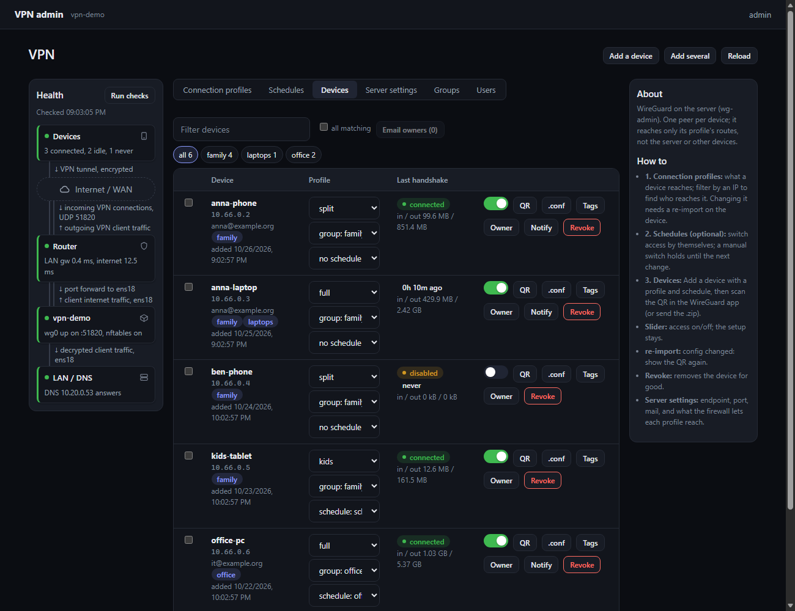
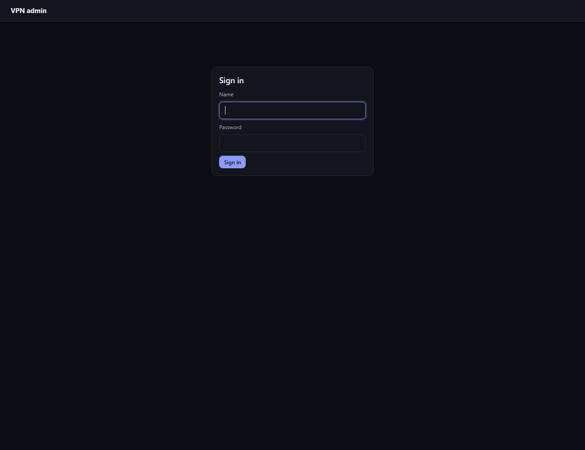
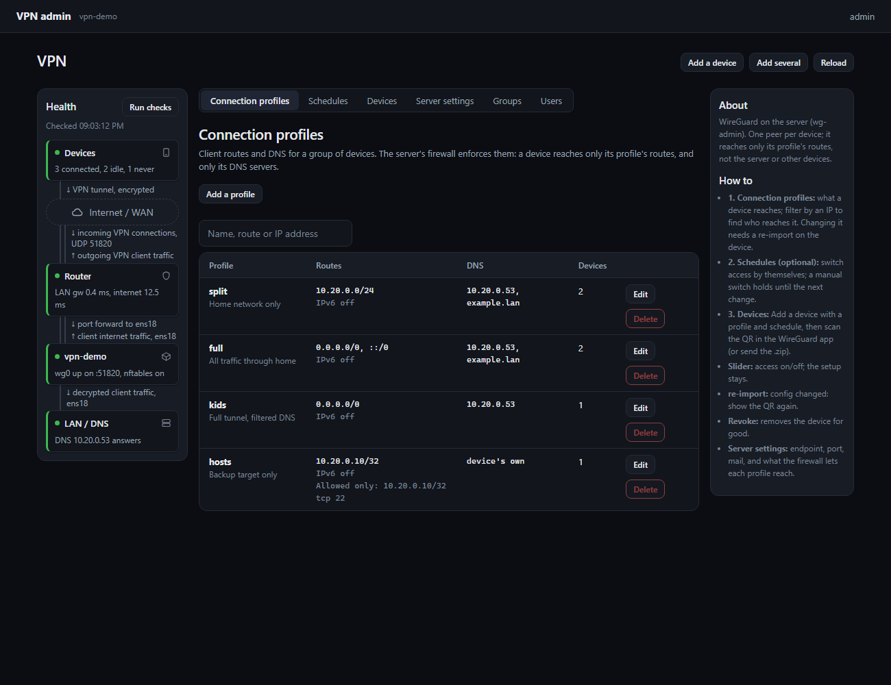
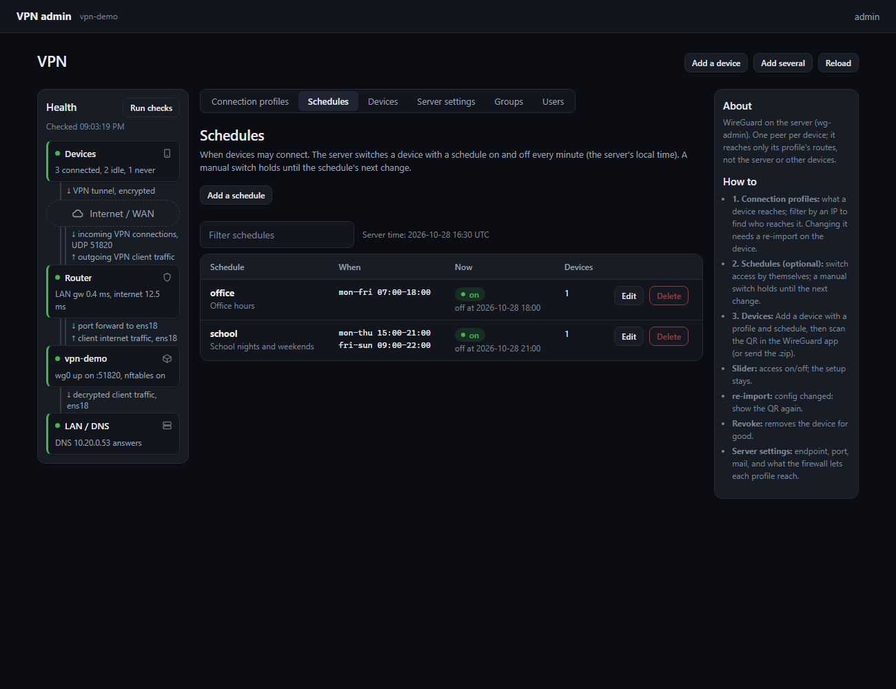
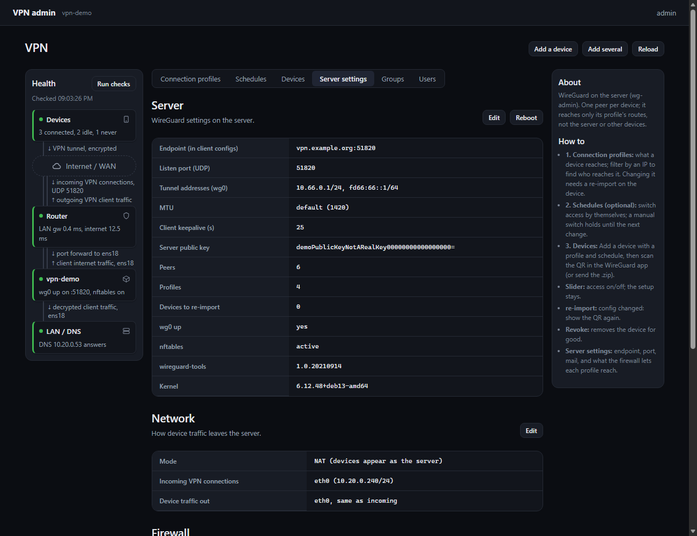
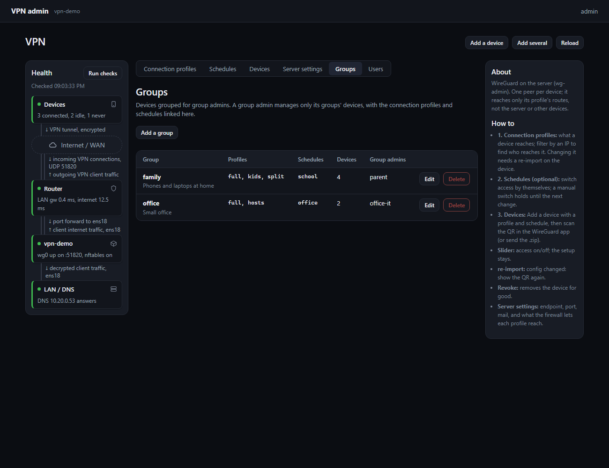
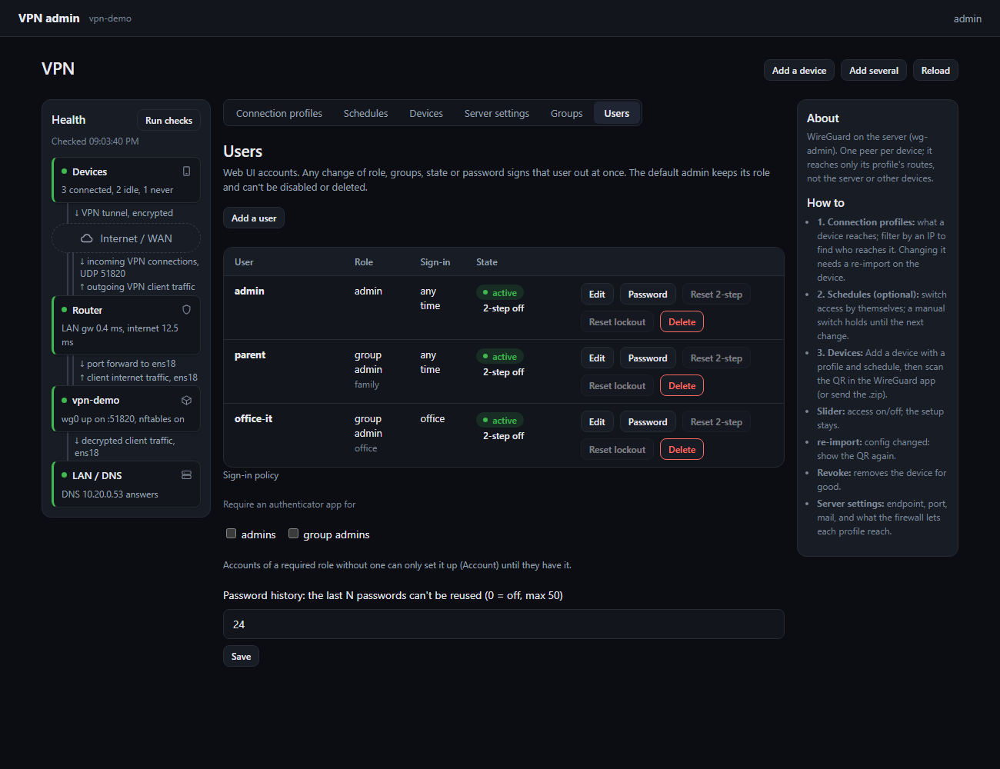

# wg-admin: WireGuard server + web UI

A self-hosted WireGuard VPN server with a web UI, installed by one script on one Debian host. Each device gets its
own key and a connection profile; the server's firewall lets a device reach only what its profile allows.
WireGuard + nftables + wg-admin (FastAPI web UI and API; nginx TLS on :8443 -> app on 127.0.0.1:8080).

## Features
- **Devices:** add one or many (CSV), QR code for the phone app, `.conf` or a `.zip` for computers, mail the setup to
  the owner, on/off switch, tags with filters, last handshake and traffic per device.
- **Connection profiles:** split tunnel (home networks only), full tunnel (all traffic), or single hosts and ports.
  Enforced on the server (nftables), not only in the client config.
- **Schedules:** weekly hours, calendar dates, valid from / until; devices switch on and off by themselves.
- **Users and groups:** admins and group admins (manage only their groups' devices), sign-in hours and expiry per
  account, optional authenticator app (TOTP) per account or required per role, password history.
- **Server settings:** endpoint, port, keepalive, NAT or routed mode, transit interface, readable firewall rules with
  an editor, mail (SMTP) settings, reboot.
- **Health map:** devices, internet, router, VPN server and LAN/DNS with live checks.
- **Backup:** encrypted export (age) with every key; restore on a new host keeps all devices working.
- **API:** every UI action is an API call; tokens for scripts (`python3 -m wgadmin token NAME`).

## Screenshots
Made-up demo data (no real names, addresses or keys).

| | |
| --- | --- |
|  Sign in (local account; optional authenticator code) |  Connection profiles: routes, DNS, allowed hosts |
|  Schedules: when devices may connect |  Server settings, network mode, firewall |
|  Groups: devices, profiles and schedules for group admins |  Users: roles, sign-in hours, 2-step, lockout reset |

## Using it
1. **Sign in** at `https://HOST:8443/` with the first admin account (install step 3 below).
2. **Server settings:** check the endpoint (the public name or address and port the devices dial) and the network
   mode (NAT or Route, see below).
3. **Connection profiles:** keep the default `split` and `full`, or add your own (routes, DNS, allowed hosts/ports).
   Changing a profile marks its devices "re-import": they need the new QR or config.
4. **Devices > Add a device:** name (e.g. `anna-phone`), profile, optional group, schedule, tags and owner email.
   - Phone: install the WireGuard app, tap **QR**, scan it in the app.
   - Computer: **.conf** (or the `.zip` with instructions), import it in the WireGuard client.
   - **Notify** mails the owner the setup (needs Server settings > Mail).
5. **Switch** a device off with its slider (the key stays) or **Revoke** it for good.
6. **Schedules (optional):** add one (e.g. `mon-fri 07:00-18:00`), pick it on the device. A manual switch holds until
   the schedule's next change.
7. **Others manage their own devices (optional):** Groups > add a group with its profiles and schedules, then
   Users > add a user with the role group admin and tick the group.

## Security
- Passwords: stored as scrypt hashes (N=2^15, r=8, p=1, 16-byte salt per password), never in clear text. Password
  history (default 24, Users > Sign-in policy). 5 failed sign-ins within 15 minutes block that network address;
  admins can reset it (Users > Reset lockout).
- Sessions: HttpOnly, Secure, SameSite=Strict cookie; changes only from wg-admin's own pages. Any role, group,
  state or password change ends that user's sessions.
- Privileges: the app runs as the unprivileged user `wgadmin` and reaches root only through `vpn-gate`, which accepts
  a fixed set of checked requests. Device keys and configs stay on the server (600).
- Every change is logged (journal; optional event URL).

| File | Role |
| --- | --- |
| install.sh | Idempotent install on any Debian 12/13 host (root): packages, wg0, firewall, wg-admin, nginx, metrics |
| uninstall.sh | Removes it; data kept unless `--purge`; wg0 always stopped (no peers without the firewall) |
| vpn-peer.sh | All VPN logic (installed as /usr/local/sbin/vpn-peer) |
| vpn-gate.sh | The only root path for wg-admin (fixed requests) |
| wgadmin/ | FastAPI app + static UI |
| wg-admin.service, wg-admin.nginx.conf | App on 127.0.0.1:8080; nginx TLS front on :8443 |
| docs/ | README screenshots (source repo: `scripts/workstation/wgadmin_shots.py`, demo data) |
| setup-vpn1.sh | (source repo only) homelab wrapper: install.sh with site values + portal SSO |

## Install on a new host
1. Debian 12/13 VM or LXC; UDP 51820 forwarded to it by the router. Unprivileged LXC: the host loads the
   `wireguard` module.
2. As root: `git clone <this repo> /root/wg-admin && bash /root/wg-admin/install.sh --endpoint vpn.example.org:51820`.
   It detects the LAN interface, gateway, DNS and LAN subnet into /etc/wireguard/vpn.env (override:
   `LAN_IF=ens18 CLIENT_DNS=10.0.0.53 bash install.sh`). TLS: self-signed until you sign /etc/wg-admin/tls.csr.
   Behind an HTTP proxy: export `http_proxy`/`https_proxy` first (apt and git use them).
3. First admin: `cd /opt/wg-admin && sudo -u wgadmin python3 -m wgadmin set-password NAME`; open https://HOST:8443/.
   Scripted: `echo "$PW" | sudo -u wgadmin python3 -m wgadmin set-password NAME` (no terminal: first stdin line).
   Everything else (endpoint, DNS, routes, NAT/Route, mail, devices) is set in the UI.
4. Update: `git -C /root/wg-admin pull && bash /root/wg-admin/install.sh` (keys, devices and settings stay).
5. Remove: `bash uninstall.sh` (keeps keys and peers) or `bash uninstall.sh --purge` (export first).

## Two-step sign-in and schedules
- Authenticator (TOTP, Google Authenticator or any app): signed in on this page, Account > Set up authenticator,
  scan, enter a code; save the 10 recovery codes. Locked out: `sudo -u wgadmin python3 -m wgadmin totp-reset NAME`.
- Schedules: weekly hours, calendar dates, valid from / expires; pick one per device. wg-admin switches devices
  every minute in this host's local time (`timedatectl set-timezone ...`). A manual switch holds until the
  schedule's next change. Data: /etc/wg-admin/totp.json, schedules.json (600 wgadmin).

## Users, groups and roles
- Roles: **admin** (everything) and **group admin** (devices of one or more groups; adds devices only into them,
  picks profiles and schedules an admin linked to the group, creates schedules for its groups; no Server settings,
  health, profiles, groups or users). Every route checks this on the server.
- Users tab (admins): add, role, groups, sign-in schedule, expiry, disable, reset password or authenticator, delete;
  "require an authenticator" per role. The first account is the default admin: it keeps its role and can't be
  disabled, scheduled, expired or deleted. Any role, group, state or password change ends that user's sessions.
- Groups tab (admins): group = devices + linked profiles + linked schedules. Data: /etc/wg-admin/access.json and
  users.json (600 wgadmin). Locked out: `sudo -u wgadmin python3 -m wgadmin set-password NAME`.

## NAT or Route
Server settings > Network. NAT (default): devices appear as this host; the router needs only the UDP port forward.
Route: devices keep their 10.66.0.N; the router needs a route for 10.66.0.0/24 to this host (and outbound NAT for
it). A second interface can carry the decrypted traffic (transit interface + next hop).

## Firewall
vpn-peer writes one table, `inet wgadmin`, to /etc/nftables.d/wgadmin.nft and replaces only that table.
On a host with its own /etc/nftables.conf, add `include "/etc/nftables.d/*.nft"` to it.
Dry run: `vpn-peer check`.

## Backup and restore
- Export (root, interactive): `vpn-peer export /root/vpn-YYYYMMDD.age`. age asks for a passphrase. The file holds
  every key; keep the passphrase somewhere else.
- Restore on a new host: install.sh (step 2), then `vpn-peer import FILE`, then install.sh again, then
  `systemctl restart wg-quick@wg0 wg-admin`. The previous state stays in /etc/wireguard.before-import-TIME.
  Devices keep working when the new host gets the same endpoint (server key comes from the export).
